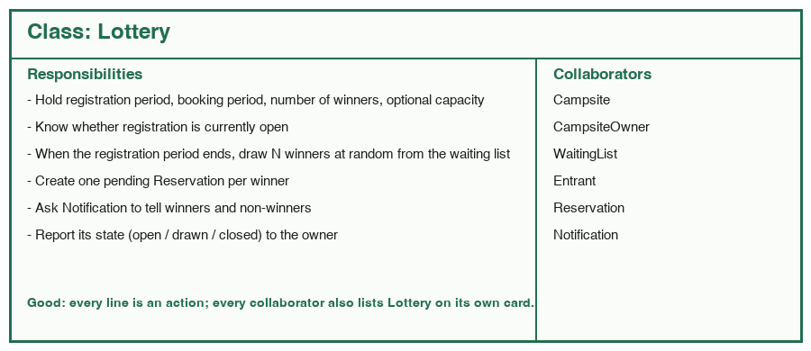
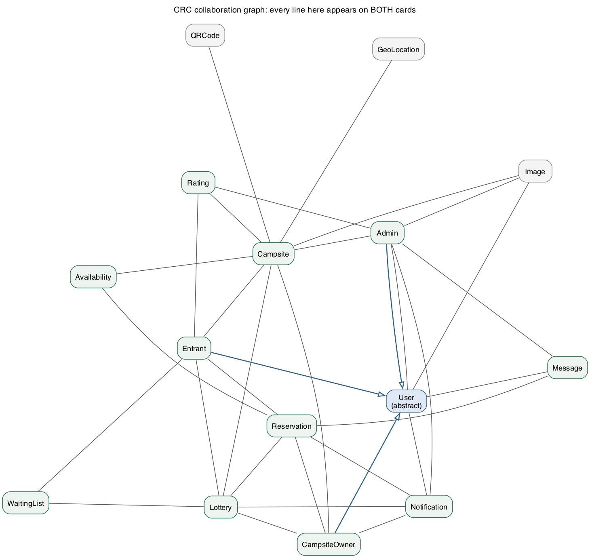
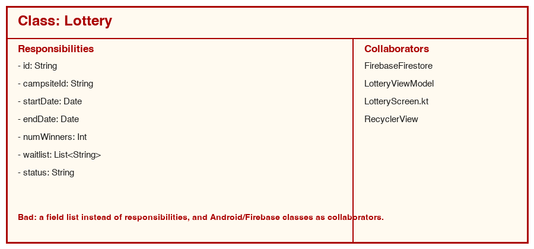

# Object-Oriented Analysis: CRC Cards

One card per important **domain** class: the things the project description talks about
(entrants, campsites, lotteries, waiting lists, reservations, notifications). Android screens,
ViewModels, repositories and Firestore helpers are *not* here; they come in Part 3 with the UML
class diagram, which will be drawn directly from these cards.

Each card has three parts, following the course
[CRC example](https://ualberta-cmput301.github.io/archive/class_participation_crc.html):

- **Class** name, plus **Generalization** (parent class) where there is one.
- **Responsibilities**: what the class *does* or *knows*, written as actions. Not a field list.
- **Collaborators**: the classes it needs to fulfil those responsibilities. Collaboration is
  mutual: if A lists B, B lists A.

The collaboration graph below is a check on the cards: every line must appear on **both** cards.
Hollow arrowheads are generalization.

## User (abstract)

| Responsibilities | Collaborators |
|---|---|
| Identify itself by the device id, with no username or password (US 01.09.01) | Image |
| Keep the display name, email and phone up to date (US 01.07.03) | Notification |
| Hold an optional profile image (US 01.08.02) | Message |
| Remember whether notifications are enabled (US 01.10.01) | |
| Delete itself and everything that only it owns (US 01.08.01) | |
| Know which roles this profile may act as (US 03.11.01) | |
| Show the app policy and guidelines on request (US 01.11.01) | |

## Entrant  (Generalization: User)

| Responsibilities | Collaborators |
|---|---|
| Search and filter campsites by location, dates and guests (US 01.01.01 to 01.01.04) | Campsite |
| Join or leave the waiting list of an open lottery (US 01.02.01, 01.02.02, 01.01.06, 01.12.01) | WaitingList |
| Respond to a win: choose campsite and dates, confirm or decline (US 01.04.01 to 01.04.03) | Lottery |
| Keep its active and past reservations and cancel one (US 01.06.01, 01.06.02, 01.07.01) | Reservation |
| Rate a campsite it has stayed at (US 01.13.01, 01.13.02) | Rating |

## CampsiteOwner  (Generalization: User)

| Responsibilities | Collaborators |
|---|---|
| Register, update and list its campsites (US 02.01.01 to 02.01.04, 02.03.01) | Campsite |
| Create and update lottery listings for one or more campsites (US 02.04.01 to 02.04.07) | Lottery |
| See active, past and cancelled reservations and reject one with a reason (US 02.07.x, 02.08.01) | Reservation |
| Broadcast a notification to a waiting list and keep a history of what was sent (US 02.10.01, 02.10.02) | Notification |
| Message an entrant who holds a reservation (US 02.12.01) | Message |

## Admin  (Generalization: User)

| Responsibilities | Collaborators |
|---|---|
| Browse and remove campsites (US 03.04.01, 03.01.01) | Campsite |
| Browse and remove profiles and offending owners (US 03.05.01, 03.02.01, 03.07.01) | User |
| Browse and remove uploaded images (US 03.06.01, 03.03.01) | Image |
| Review the log of every notification sent (US 03.08.01) | Notification |
| Review the log of owner-to-entrant messages (US 03.12.01) | Message |
| Remove ratings and reviews that violate policy (US 03.09.01, 03.10.01) | Rating |

## Campsite

| Responsibilities | Collaborators |
|---|---|
| Hold name, description, maximum occupancy, price, tags, rules and cancellation policy (US 02.01.02) | CampsiteOwner |
| Hold its geolocation and show it on a map | GeoLocation |
| Hold its optional promotional image | Image |
| Own a unique QR code that links to its details (US 02.02.01) | QRCode |
| Keep the availability schedule and report booked dates (US 02.06.01, 01.04.01) | Availability |
| Know which lotteries it is listed in | Lottery |
| Summarise its ratings into a score (US 01.01.04) | Rating, Admin |
| Be found and viewed by entrants through search, filters or its QR code (US 01.01.01 to 01.01.05, 01.12.01) | Entrant |

## Availability

| Responsibilities | Collaborators |
|---|---|
| Represent one bookable date range of a campsite with a price | Campsite |
| Know whether it is free, held by a pending winner, or reserved | Reservation |

## Lottery

| Responsibilities | Collaborators |
|---|---|
| Hold the registration period, booking period, number of winners and optional capacity (US 02.04.03 to 02.04.07) | Campsite, CampsiteOwner |
| List one campsite, several campsites, or campsites of several owners (US 02.04.01, 02.04.02, 02.02.02) | |
| Know whether registration is currently open | WaitingList |
| Draw N winners at random when the registration period ends (US 02.05.01) | Entrant |
| Create one pending Reservation per winner | Reservation |
| Ask Notification to tell winners and non-winners (US 01.03.01, 01.03.02) | Notification |
| Report its state (open / drawn / closed) | |

## WaitingList

| Responsibilities | Collaborators |
|---|---|
| Keep the entrants who registered interest in one lottery, in join order | Lottery |
| Enforce the optional capacity (US 02.04.07) | Entrant |
| Add and remove an entrant (US 01.02.01, 01.02.02) | |
| Show the owner who has joined (US 02.09.01) | |
| Hand a random sample of N entrants to the lottery | |

Note for students: the project glossary defines *waiting list* as "a list of entrants who show
interest". It is the lottery pool, **not** a stand-by list for when a campsite is full.

## Reservation

| Responsibilities | Collaborators |
|---|---|
| Link one entrant, one campsite and one availability range | Entrant, Campsite, Availability |
| Move through its states: pending (won) to confirmed to cancelled / rejected / past | Lottery |
| Require rule acknowledgement before confirming (US 02.11.01) | CampsiteOwner |
| Send a confirmation when confirmed or cancelled (US 01.05.01, 01.07.02) | Notification |
| Record the rejection reason and trigger the refund notice (US 02.08.01) | |
| Export itself as CSV (US 01.05.02, 01.07.02) | Message |

## Notification

| Responsibilities | Collaborators |
|---|---|
| Carry a typed message (win, lose, confirmed, cancelled, rejected, owner broadcast) to one or many users | User |
| Respect the recipient's opt-out (US 01.10.01) | Lottery |
| Be kept in a log that admins can review (US 03.08.01) | CampsiteOwner, Reservation, Admin |

## Message

| Responsibilities | Collaborators |
|---|---|
| Hold one text sent between an owner and an entrant about a specific reservation (US 02.12.01, 01.14.01) | User |
| Be kept in a log that admins can review (US 03.12.01) | Reservation, Admin |

## Rating

| Responsibilities | Collaborators |
|---|---|
| Hold one entrant's score (and optional review text) for one campsite (US 01.13.01, 01.13.02) | Entrant, Campsite |
| Be removable by an admin (US 03.09.01, 03.10.01) | Admin |

## Image, GeoLocation, QRCode (value objects)

| Class | Responsibilities | Collaborators |
|---|---|---|
| Image | Hold the storage reference of an uploaded picture and who uploaded it; be removable by admin | User, Campsite, Admin |
| GeoLocation | Hold latitude and longitude; convert to a map marker | Campsite |
| QRCode | Encode a campsite id; render as an image for posters | Campsite |

## What a bad card looks like

Fields instead of responsibilities, and framework classes instead of domain collaborators.
A marker cannot tell from this card what a Lottery *does*, and none of the "collaborators" will
have a card of their own.

## Self-check used on these cards

- Every user story in [Product-Backlog](Product-Backlog.md) is mentioned on at least one card.
- Every collaborator named on a card has a card of its own.
- Every pair appears on both cards (the graph above is generated from the cards).
- Names match the backlog and the mockups: *WaitingList*, *Lottery*, *Reservation*, not "waitlist" on one page and "queue" on another.
