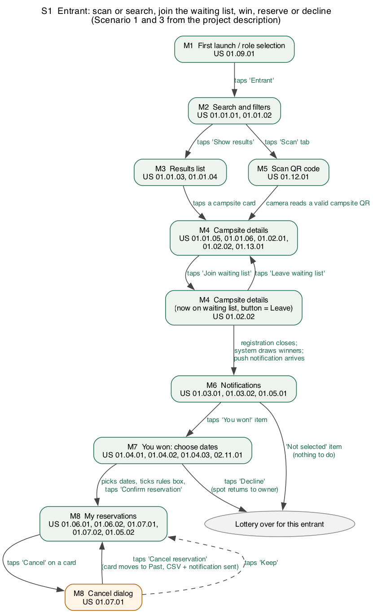
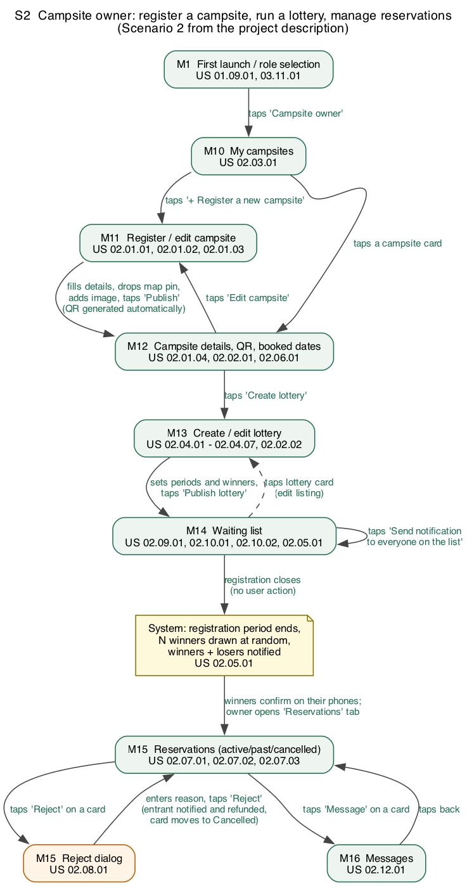
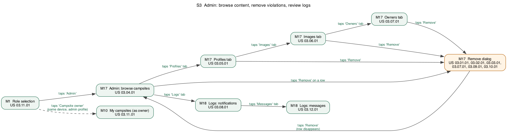
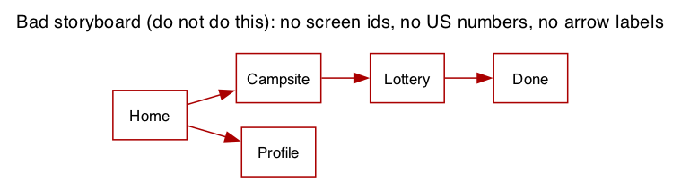

# Storyboard Sequences

A storyboard shows **how the user moves between the screens** on [UI Mockups](UI-Mockups.md).
Every box is a screen (its mockup id and the user stories it covers); **every arrow is labelled
with the user action or system event that causes the transition**. Dashed arrows are
"nothing changed" paths. The three storyboards follow the three scenarios in the
[project description](https://ualberta-cmput301.github.io/projects/project_problem_descr.html).

Source files: `scripts/diagrams/*.dot`, rendered with `scripts/render_diagrams.sh`.
draw.io, Figma or paper work just as well; what matters is the labelled arrows and the US numbers.

## S1  Entrant: scan or search, join the waiting list, win, reserve or decline

Scenario 1 (QR code at the Van Vliet Complex, wins, dates already taken, declines) and
Scenario 3 (filters by date and location, joins several lotteries, wins one, later rejected by the owner).

Walk-through: the entrant reaches the campsite either by filtering (M2 to M3 to M4) or by scanning a
poster (M2 to M5 to M4). Joining flips the button to *Leave*. Nothing happens on the phone until the
registration period ends; then the system draws and a notification arrives (M6). A winner opens M7,
sees which dates are still free, and either confirms (reservation appears in M8) or declines.
From M8 the entrant can cancel; the dialog states that a confirmation and CSV follow.

## S2  Campsite owner: register a campsite, run a lottery, manage reservations

Scenario 2 (Hinton-Grande Cache campsite, 8 people, May weekends, publish, create lottery, QR on posters).

Walk-through: the owner registers the campsite (M11); publishing generates the QR code shown on
M12. From M12 the owner creates a lottery (M13) and then watches the waiting list grow (M14).
The yellow note is a **system event**: the draw happens without any user action when registration
closes. Winners confirm on their own phones; the owner sees them under Reservations (M15) and can
reject with a reason or message the entrant (M16).

## S3  Admin: browse content, remove violations, review logs

Walk-through: the admin lands on the browse screen and switches tabs between campsites, profiles,
images and owners; every tab shares the same Remove dialog. Logs of notifications and messages are
on M18. The dashed arrow shows the admin using the same device as a campsite owner (US 03.11.01).

## What a bad storyboard looks like

No screen ids, no user story numbers, no action on the arrows. A marker cannot tell which
requirement any box satisfies or what the user did to get there. This is the most common reason
teams lose marks on this deliverable.
