# UI Mockups

Low-fidelity mockups of every main screen and major dialog. Each image is followed by
**what the numbered markers point at** and **which user stories the screen covers**.
The full requirement-to-screen mapping is on
[US-to-Screen-Traceability](US-to-Screen-Traceability.md); how the screens connect is on
[Storyboards](Storyboards.md).

Images are PNG files committed to this repository (`wiki/images/`), so they render for anyone
who can open the repo. Links to Figma or Google Drive are **not** a substitute. Drawn with a
script (`scripts/gen_mockups.py`); hand drawings, Figma or draw.io exports are equally fine as
long as the PNG is embedded and legible.

Conventions: green filled button = primary action; outlined button = secondary; red = destructive;
a dimmed screen with a white box = a dialog over that screen.

---

## Shared screens

### M1  First launch / role selection
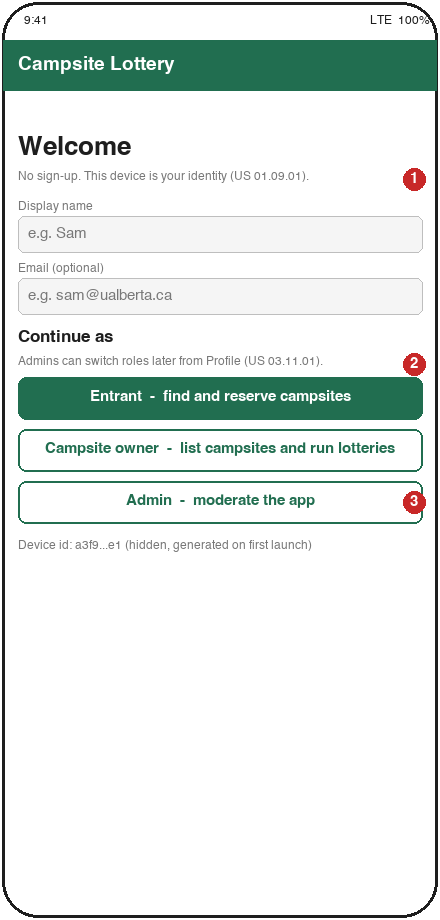

1. No account creation. The app generates a device id on first launch and stores the profile under it (US 01.09.01).
2. An admin profile can later switch role from Profile, so one person can act as owner or entrant too (US 03.11.01).
3. Three entry points, one per actor. The choice decides which bottom navigation bar is shown.

**Covers:** US 01.09.01, 03.11.01

### M6  Notifications
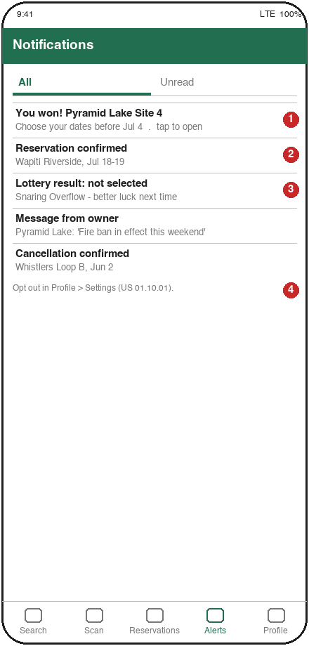

1. Win notification: tapping it opens M7 (US 01.03.01).
2. Reservation confirmed after the entrant confirmed in M7 (US 01.05.01); cancellation confirmations arrive the same way (US 01.07.02).
3. Lose notification, informational only (US 01.03.02).
4. Opt-out lives in Profile so the list itself stays simple (US 01.10.01).

**Covers:** US 01.03.01, 01.03.02, 01.05.01, 01.07.02

### M9  Profile and settings
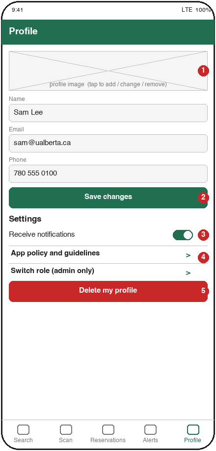

1. Profile image: add, replace or remove (US 01.08.02, optional story).
2. Name, email, phone editable in place (US 01.07.03).
3. Notification opt-out toggle (US 01.10.01).
4. App policy and guidelines page (US 01.11.01).
5. Delete profile, red because it is irreversible; asks for confirmation (US 01.08.01).

**Covers:** US 01.07.03, 01.08.01, 01.08.02, 01.10.01, 01.11.01

---

## Entrant

### M2  Campsite search and filters
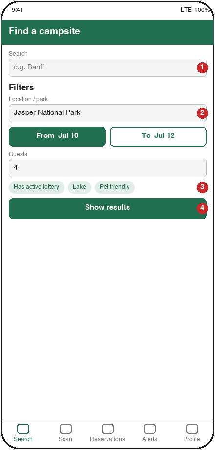

1. Free-text search over campsite name and park (US 01.01.01).
2. Filters: location, date range, number of guests (US 01.01.02).
3. Extra chips are optional refinements, not required by any story.
4. Runs the query and opens M3.

**Covers:** US 01.01.01, 01.01.02

### M3  Results list
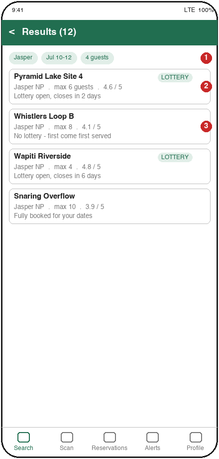

1. The active filters are repeated so the user knows why these results appear (US 01.01.03).
2. Each card shows name, location, maximum occupancy and rating (US 01.01.04); the LOTTERY badge shows an active lottery.
3. Campsites without a lottery are still listed (Scenario 3 in the project description).

**Covers:** US 01.01.01, 01.01.03, 01.01.04

### M4  Campsite details
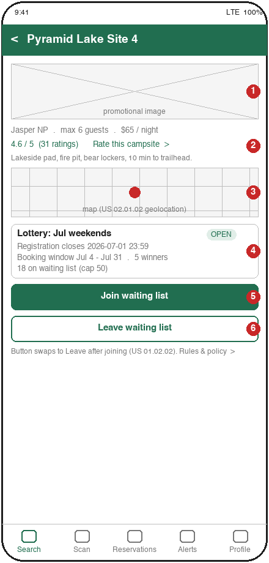

1. Promotional image uploaded by the owner.
2. Rating summary and the entry point to rate the campsite (US 01.13.01; review text is the optional US 01.13.02).
3. Map with the owner-provided geolocation.
4. Lottery card: registration close, booking window, number of winners, waiting-list size (US 01.01.06).
5. Join the waiting list (US 01.02.01). Only shown while registration is open.
6. Leave the waiting list (US 01.02.02). In the real app only one of 5 / 6 is visible at a time; both are drawn here so the mockup documents both states.

**Covers:** US 01.01.05, 01.01.06, 01.02.01, 01.02.02, 01.12.01 (reached from M5), 01.13.01, 01.13.02

### M5  Scan QR code
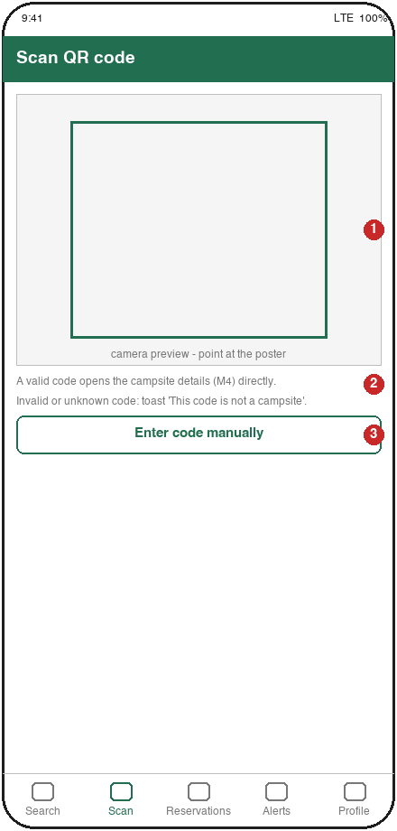

1. Live camera preview; the QR payload is the campsite id.
2. A valid code navigates straight to M4 (US 01.12.01).
3. Manual entry fallback for a damaged poster.

**Covers:** US 01.12.01

### M7  You won: choose dates and confirm (or decline)
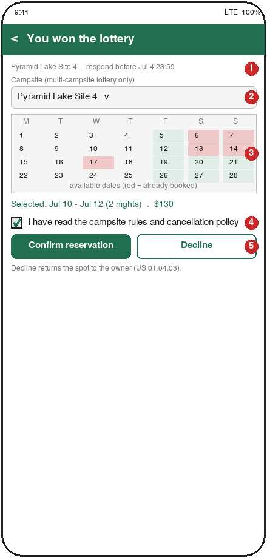

1. Deadline to respond comes from the lottery's booking period.
2. Campsite selector, only enabled for a multi-campsite lottery (US 01.04.02).
3. Calendar: already-booked dates are red and cannot be chosen (US 01.04.01).
4. Rules and policy acknowledgement required before confirming (US 02.11.01).
5. Confirm creates the reservation and a confirmation notification (US 01.05.01); Decline releases the spot (US 01.04.03).

**Covers:** US 01.04.01, 01.04.02, 01.04.03, 01.05.01, 02.11.01

### M8  My reservations and cancel dialog
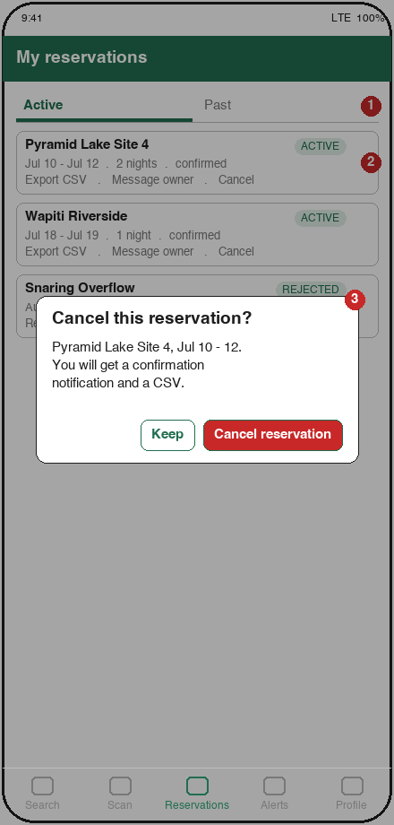

1. Active and Past tabs (US 01.06.01, 01.06.02). Rejected and cancelled reservations show under Past with their status.
2. Per-reservation actions: export CSV (US 01.05.02), message the owner (optional US 01.14.01), cancel (US 01.07.01).
3. Cancel dialog explains what happens next: confirmation notification and CSV (US 01.07.02).

**Covers:** US 01.05.02, 01.06.01, 01.06.02, 01.07.01, 01.07.02, 01.14.01

---

## Campsite owner

### M10  My campsites
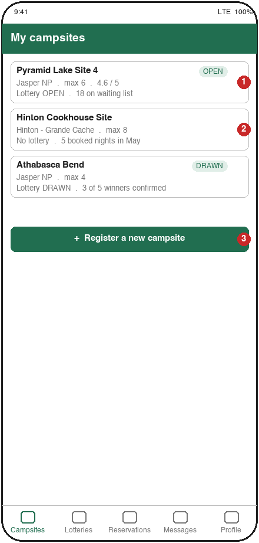

1. One card per campsite with lottery status and waiting-list size (US 02.03.01).
2. A campsite without a lottery still shows booked nights.
3. Entry point to M11 (US 02.01.01).

**Covers:** US 02.01.01, 02.03.01

### M11  Register / edit campsite
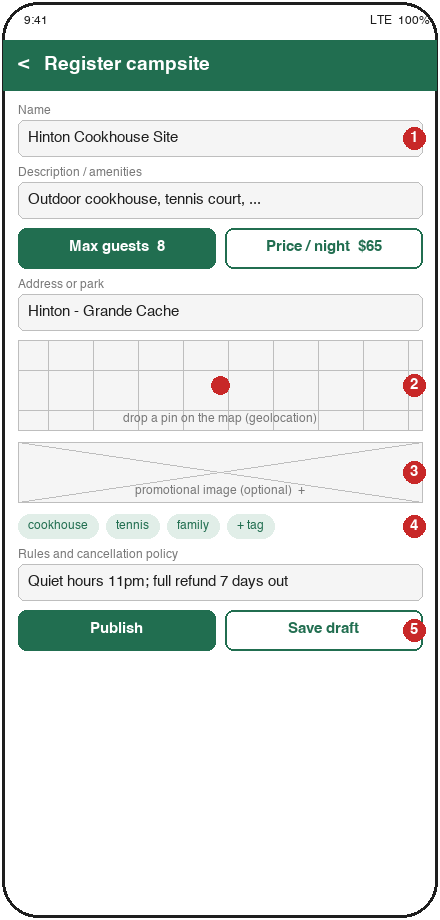

1. Name, description/amenities, maximum occupancy, price (US 02.01.02).
2. Map pin for the geolocation (US 02.01.02, Geolocation feature).
3. Optional promotional image (US 02.01.02, Image Upload feature).
4. Tags.
5. Publish or save as draft. The same screen, pre-filled, is used for updates (US 02.01.03).

**Covers:** US 02.01.01, 02.01.02, 02.01.03

### M12  Campsite details, QR code and booked dates (owner view)
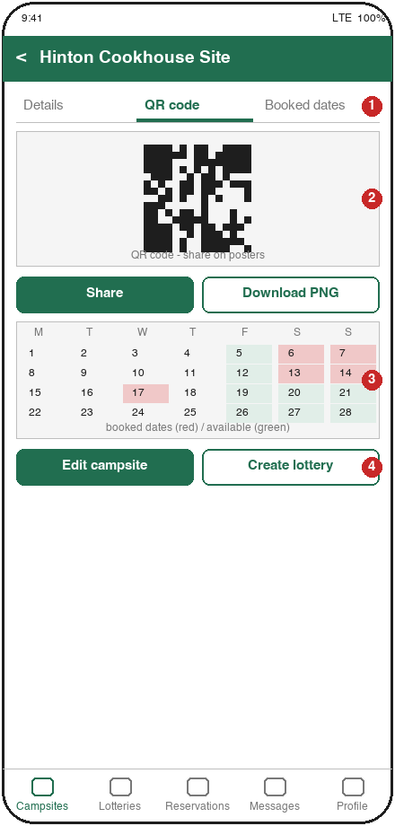

1. Tabs: Details (US 02.01.04), QR code, Booked dates.
2. QR code generated automatically on publish; share or download for posters (US 02.02.01).
3. Calendar of currently booked dates (US 02.06.01).
4. Edit campsite (back to M11) or create a lottery (to M13).

**Covers:** US 02.01.04, 02.02.01, 02.06.01

### M13  Create / edit lottery
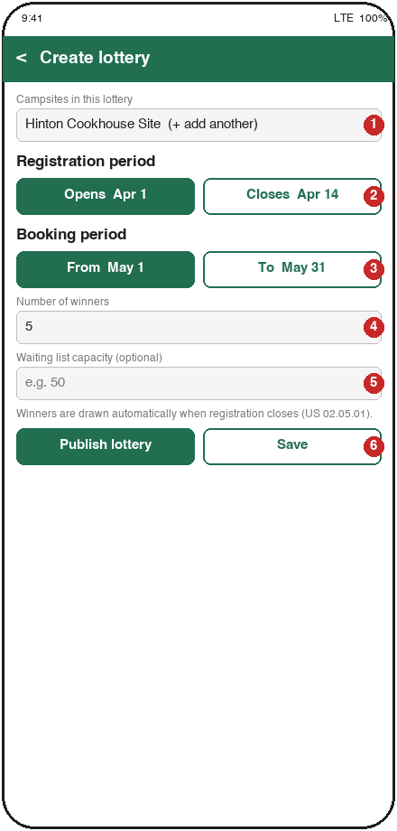

1. One or more campsites in the lottery (US 02.04.01, 02.04.02; other owners' campsites is the optional US 02.02.02).
2. Registration period (US 02.04.03).
3. Booking period (US 02.04.04).
4. Number of winners (US 02.04.05).
5. Optional waiting-list capacity (US 02.04.07).
6. Publish or save. Opening an existing lottery shows the same screen pre-filled (US 02.04.06).

**Covers:** US 02.02.02, 02.04.01 to 02.04.07

### M14  Waiting list and send notification
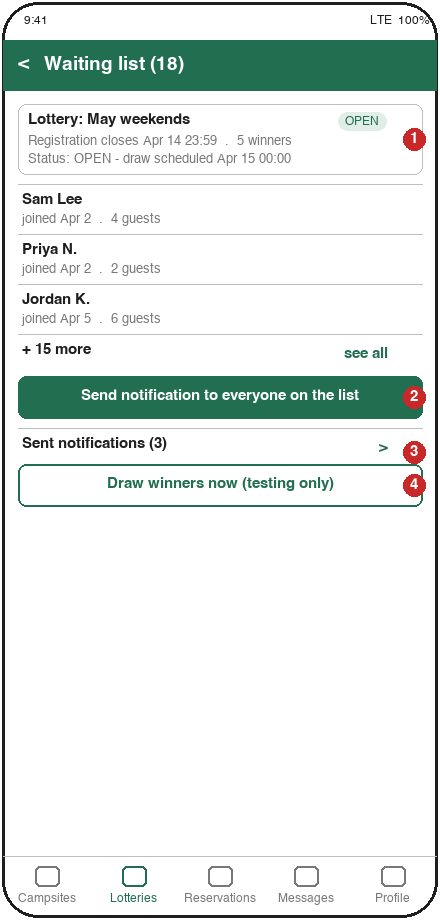

1. Lottery status and the scheduled automatic draw time (US 02.05.01).
2. Broadcast a notification to everyone on the waiting list (US 02.10.01).
3. History of sent notifications (US 02.10.02).
4. Manual draw, for testing and demos only; the real draw is automatic when registration closes.

**Covers:** US 02.05.01, 02.09.01, 02.10.01, 02.10.02

### M15  Reservations and reject dialog
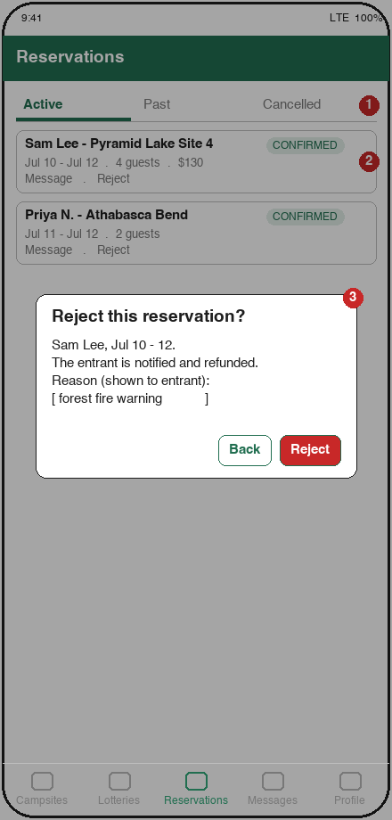

1. Active / Past / Cancelled tabs (US 02.07.01, 02.07.02, 02.07.03).
2. Per-reservation actions: message (US 02.12.01) and reject.
3. Reject dialog with a reason that is sent to the entrant (US 02.08.01; Scenario 3 forest-fire case).

**Covers:** US 02.07.01, 02.07.02, 02.07.03, 02.08.01, 02.12.01

### M16  Messages
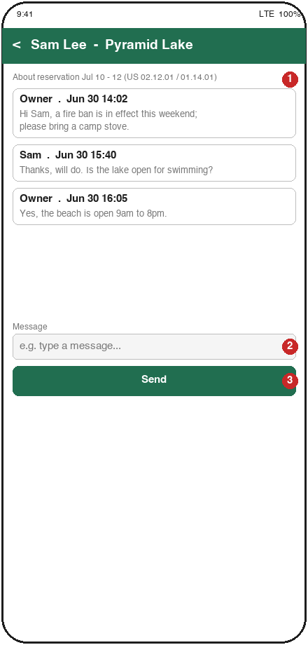

1. Every conversation is attached to one reservation, so admins can audit it (US 03.12.01).
2. Owner writes to the reserving entrant (US 02.12.01); the entrant can reply (optional US 01.14.01).
3. Send.

**Covers:** US 01.14.01, 02.12.01

---

## Admin

### M17  Browse and remove
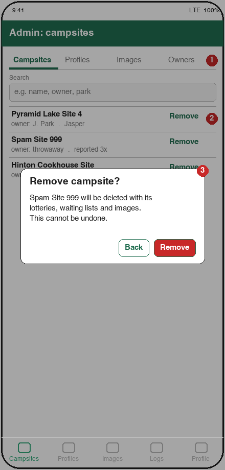

1. Tabs for campsites, profiles, images and owners (US 03.04.01, 03.05.01, 03.06.01).
2. Every row has a Remove action (US 03.01.01, 03.02.01, 03.03.01, 03.07.01; ratings and reviews in the optional US 03.09.01, 03.10.01).
3. Confirmation dialog that lists what else is deleted.

**Covers:** US 03.01.01 to 03.07.01, 03.09.01, 03.10.01

### M18  Notification and message logs
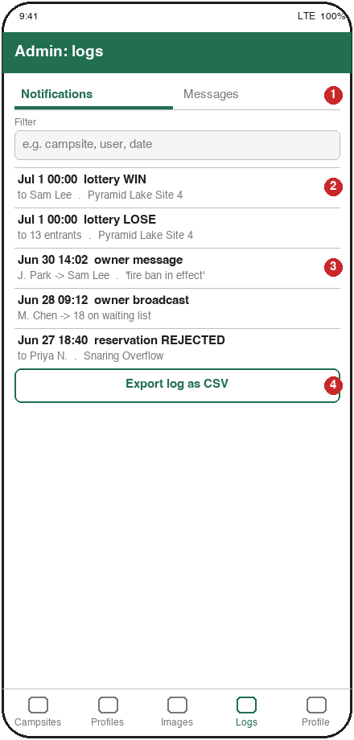

1. Notifications log and messages log (US 03.08.01, 03.12.01).
2. Lottery results sent by the system.
3. Owner-to-entrant messages.
4. Export for offline review.

**Covers:** US 03.08.01, 03.12.01
